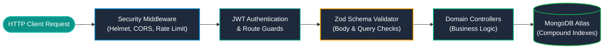
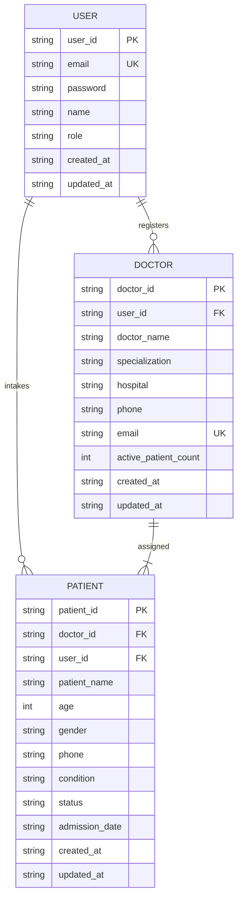

# Doctor Tracker: Standalone Backend REST API

Doctor Tracker API is a production-grade, standalone RESTful backend web service built with Node.js, Express, TypeScript, and MongoDB via Mongoose ODM. Engineered to serve as the high-throughput persistence and business logic tier for clinical operations, the service provides secure JWT authentication, Zod input validation, atomic practitioner caseload tracking with automated status recalculation, compound database indexing, and single-pass `$facet` analytics with sub-20ms query latency.

---

### Live API Deployment & Submission Links

| Deliverable | Service Host | Live Endpoint | Status |
| :--- | :--- | :--- | :--- |
| **Production API** | Railway | [doctor-tracker-backend-production.up.railway.app](https://doctor-tracker-backend-production.up.railway.app) | Live (HTTP 200) |
| **Health Check** | Railway | [doctor-tracker-backend-production.up.railway.app/health](https://doctor-tracker-backend-production.up.railway.app/health) | Passing (HTTP 200) |
| **Backend GitHub Repo** | GitHub | [github.com/zihaduzzamaan/doctor-tracker-backend](https://github.com/zihaduzzamaan/doctor-tracker-backend) | Public Repository |
| **Unified Monorepo** | GitHub | [github.com/zihaduzzamaan/doctor-tracker](https://github.com/zihaduzzamaan/doctor-tracker) | Full Monorepo |

### Evaluation Administrator Credentials

| Role | Email Address | Password | Permissions |
| :--- | :--- | :--- | :--- |
| **Clinic Administrator** | `admin@clinic.com` | `password123` | Full access across all clinical departments, practitioners, and admissions |

---

# 1. Description

Doctor Tracker API is a decoupled, standalone REST service delivering clinical data operations with strict data integrity guarantees. It enforces server-side validation using Zod, isolates tenant data via JWT middleware, and prevents race conditions and caseload counter drift through atomic increments on admission and deterministic re-aggregation upon status updates or practitioner reassignments. The API is hosted on Railway Cloud and backed by a MongoDB Atlas cluster.

---

# 2. Setup Guide

Follow these step-by-step instructions to run the backend REST API locally.

### Prerequisites
* **Node.js**: `v20.0.0` or higher (`v24.19.0` recommended)
* **npm**: `10.0.0` or higher (`11.17.0` recommended)
* **MongoDB**: A running local MongoDB instance (`mongodb://localhost:27017`) or a free MongoDB Atlas connection string

### Step-by-Step Installation

```bash
# 1. Clone the repository
git clone https://github.com/zihaduzzamaan/doctor-tracker-backend.git
cd doctor-tracker-backend

# 2. Install production and development dependencies
npm install

# 3. Configure environment variables
cp .env.example .env

# 4. Compile TypeScript source code
npm run build

# 5. Seed the database with demo admin, 10 doctors, and 40 patient cases
npm run seed

# 6. Start the local development server (Port 5000)
npm run dev
```

### Environment Variables Template (`.env.example`)

```bash
PORT=5000
NODE_ENV=development
CLIENT_URL=http://localhost:3000
MONGODB_URI=mongodb://localhost:27017/doctor_tracker
JWT_SECRET=doctor_tracker_super_secret_jwt_key_2026_clinic
JWT_EXPIRES_IN=7d
```

---

# 3. System Architecture

Doctor Tracker API isolates transport security, route guarding, schema validation, and domain controllers into discrete pipeline layers:



### Database Schema & Entity Relationships



### Collections & Indexing Summary

| Collection | Key Fields | Index Strategy | Operational Purpose |
| :--- | :--- | :--- | :--- |
| **`users`** | `email`, `role` | `{ email: 1 }` (Unique) | O(1) administrator login resolution |
| **`doctors`** | `hospital`, `specialization`, `createdAt` | `{ createdAt: -1 }` + Text Index | Sub-20ms sorted pagination without in-memory sort |
| **`patients`** | `doctor_id`, `status`, `admission_date` | Compound `{ doctor_id: 1, status: 1 }` + `{ admission_date: -1 }` | Instant slide-over Patient Drawer caseload retrieval |

---

# 4. Technical Decisions

### Decision 1: Dedicated Express Web Service vs. Serverless Functions
* **Problem**: Serverless cloud functions incur cold-start connection overhead and struggle with MongoDB connection pool exhaustion under concurrent spikes.
* **Choice**: Implemented an autonomous Express TypeScript web service on Railway Cloud.
* **Impact**: Persistent connection pool eliminates cold-start latency, keeps database sockets hot, isolates backend scaling from frontend rendering, and provides a standalone REST API ready for future mobile integrations.

### Decision 2: Single-Roundtrip `$facet` Aggregation Pipeline
* **Problem**: The clinical dashboard requires total counts, status breakdowns, top diagnosis distributions, and chronological intake trends. Executing four sequential queries causes roundtrip network latency waterfalls.
* **Choice**: Replaced multiple sequential queries with a single MongoDB `$facet` aggregation pipeline executing concurrently with doctor queries via `Promise.all`.
* **Impact**: Reduces network roundtrips between the API and MongoDB Atlas from four to one, delivering complete analytics aggregation in under 15ms.

---

# 5. REST API Endpoints Specification

Base URL: `https://doctor-tracker-backend-production.up.railway.app/api/v1`

All endpoints except authentication and health checks require an `Authorization: Bearer <token>` header.

### Authentication Endpoints (`/api/v1/auth`)
| HTTP Method | Route | Access | Operational Purpose |
| :--- | :--- | :--- | :--- |
| `POST` | `/auth/login` | Public | Authenticates credentials and returns a 7-day signed JWT session token |
| `GET` | `/auth/me` | Protected | Returns the authenticated administrator profile |

### Doctor Practitioner Endpoints (`/api/v1/doctors`)
| HTTP Method | Route | Access | Operational Purpose |
| :--- | :--- | :--- | :--- |
| `GET` | `/doctors` | Protected | Lists doctors with text search, specialization, hospital filters, and pagination |
| `GET` | `/doctors/:id` | Protected | Retrieves a doctor profile with all assigned patient admission records |
| `POST` | `/doctors` | Protected | Registers a new practitioner with strict Zod validation |
| `PUT` | `/doctors/:id` | Protected | Updates existing doctor credentials or department assignments |
| `DELETE` | `/doctors/:id` | Protected | Removes doctor and cascades deletion to assigned patient records |

### Patient Admission Endpoints (`/api/v1/patients`)
| HTTP Method | Route | Access | Operational Purpose |
| :--- | :--- | :--- | :--- |
| `GET` | `/patients` | Protected | Lists all clinical admissions with multi-field status, condition, and doctor filters |
| `GET` | `/patients/:id` | Protected | Retrieves single patient record with populated doctor details |
| `POST` | `/patients` | Protected | Intakes a new patient and automatically increments the assigned doctor's active count |
| `PUT` | `/patients/:id` | Protected | Modifies patient condition, status, or reassigns doctor with count synchronization |
| `DELETE` | `/patients/:id` | Protected | Discharges/removes patient and decrements doctor's active patient count |

### Analytics Endpoints (`/api/v1/analytics`)
| HTTP Method | Route | Access | Operational Purpose |
| :--- | :--- | :--- | :--- |
| `GET` | `/analytics/summary` | Protected | Executes single-pass `$facet` aggregation returning totals, status distribution, and trends |

---

# 6. License

This project is licensed under the MIT License.
