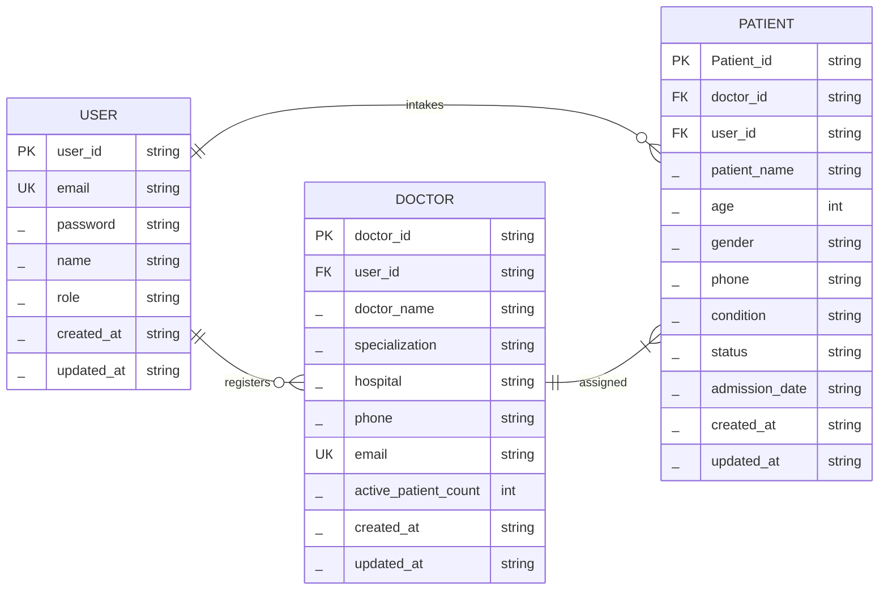

# Database Design: Doctor Tracker

This document describes the database design, data structures, and indexing strategies for the Doctor Tracker application. The database engine is MongoDB.

> *Tip: Install the [Markdown Preview Mermaid Support](https://marketplace.visualstudio.com/items?itemName=bierner.markdown-mermaid) extension in VS Code to preview the diagrams below.*

---

# 1. Entity-Relationship Model

The diagram below illustrates the structural relationships between the three core entities: **USER**, **DOCTOR**, and **PATIENT**. The diagram is rendered horizontally with dedicated primary and foreign key columns, clean attribute names (`user_id`, `doctor_id`, `Patient_id`), and zero description clutter.

---

# 2. Collection Schemas & Field Definitions

### 2.1 Users Collection (`users`)

The users collection stores credentials and access roles for clinic coordinators and administrators.

| Key Type | Field Name | Data Type | Required | Unique | Description |
| :--- | :--- | :--- | :--- | :--- | :--- |
| **PK** | `user_id` | ObjectId | Yes | Yes | Auto-generated unique document identifier |
| **UK** | `email` | String | Yes | Yes | Lowercase email address used for portal authentication |
| | `password` | String | Yes | No | Salted and hashed password string |
| | `name` | String | Yes | No | Full display name of the administrator |
| | `role` | String | Yes | No | System access level with a default value of admin |
| | `created_at` | Date | Yes | No | Timestamp recorded at document creation |
| | `updated_at` | Date | Yes | No | Timestamp updated on document modification |

### 2.2 Doctors Collection (`doctors`)

The doctors collection stores profiles for medical practitioners, their department affiliations, and an atomic counter for assigned patients.

| Key Type | Field Name | Data Type | Required | Unique | Description |
| :--- | :--- | :--- | :--- | :--- | :--- |
| **PK** | `doctor_id` | ObjectId | Yes | Yes | Auto-generated unique document identifier |
| **FK1** | `user_id` | ObjectId | Yes | No | Foreign key referencing the administrator in `users` |
| | `doctor_name` | String | Yes | No | Full legal name of the medical practitioner |
| | `specialization` | String | Yes | No | Medical department such as Cardiology or Pediatrics |
| | `hospital` | String | Yes | No | Name of the clinic branch or hospital facility |
| | `phone` | String | Yes | No | Direct contact telephone number |
| **UK** | `email` | String | Yes | Yes | Unique professional email address |
| | `active_patient_count` | Number | Yes | No | Atomic counter tracking assigned patient cohorts |
| | `created_at` | Date | Yes | No | Timestamp of doctor registration |
| | `updated_at` | Date | Yes | No | Timestamp of the most recent profile update |

### 2.3 Patients Collection (`patients`)

The patients collection stores clinical intake records, demographic details, diagnosis information, and a reference to the attending practitioner.

| Key Type | Field Name | Data Type | Required | Unique | Description |
| :--- | :--- | :--- | :--- | :--- | :--- |
| **PK** | `Patient_id` | ObjectId | Yes | Yes | Auto-generated unique document identifier |
| **FK1** | `doctor_id` | ObjectId | Yes | No | Foreign key referencing the assigned practitioner in `doctors` |
| **FK2** | `user_id` | ObjectId | Yes | No | Foreign key referencing the administrator in `users` |
| | `patient_name` | String | Yes | No | Full legal name of the patient |
| | `age` | Number | Yes | No | Validated integer representing patient age |
| | `gender` | String | Yes | No | Classification value: male, female, or other |
| | `phone` | String | Yes | No | Contact telephone number for the patient or guardian |
| | `condition` | String | Yes | No | Clinical diagnosis or primary medical complaint |
| | `status` | String | Yes | No | Urgency state: admitted, stable, critical, or discharged |
| | `admission_date` | Date | Yes | No | Formal date of patient registration or clinic admission |
| | `created_at` | Date | Yes | No | Timestamp of record creation |
| | `updated_at` | Date | Yes | No | Timestamp of the most recent record edit |

---

# 3. Indexing Strategy & Query Optimization

Indexes are established to avoid full collection scans and ensure that queries complete under twenty milliseconds.

| Collection | Indexed Fields | Index Type | Query Purpose | Expected Performance |
| :--- | :--- | :--- | :--- | :--- |
| **`users`** | `email` (ascending) | Unique B-tree | Immediate lookup during user authentication | Single-document index lookup |
| **`doctors`** | `hospital`, `specialization`, `created_at` | Compound B-tree | Multi-attribute filtering by clinic and department with date sorting | Covered index scan (`IXSCAN`) |
| **`doctors`** | `doctor_name`, `specialization`, `email` | Full-Text Index | Typo-tolerant keyword search across doctor attributes | Text search scan without collection scan |
| **`patients`** | `doctor_id`, `admission_date` | Compound B-tree | Slide-out cohort drawer listing patients for one doctor | Covered index scan (`IXSCAN`) |
| **`patients`** | `condition`, `status`, `admission_date` | Compound B-tree | Dedicated patient page filtering by diagnosis, status, and date | Covered index scan (`IXSCAN`) |
| **`patients`** | `patient_name`, `condition` | Full-Text Index | Search bar querying patient names and medical conditions | Text search scan without collection scan |

---

# 4. Data Aggregation & Analytics Design

### 4.1 Single-Pass Dashboard Aggregation

The administrative dashboard requires aggregate statistics including total doctor count, total patient count, average patients per doctor, weekly admission trends, and department distributions. Rather than executing multiple sequential queries, the database service uses a single multi-faceted aggregation pipeline.

The pipeline processes documents in four parallel facets:
First, a counting facet tallies the total number of admitted patients.
Second, a grouping facet groups patients by current clinical status to display urgency distributions.
Third, a time-filtered facet counts admissions recorded within the trailing seven days for trend visualization.
Fourth, a lookup facet joins patient records with doctor documents to group cohort counts by medical specialization.

Following pipeline execution, the backend calculates the ratio of patients per doctor by dividing total patient count by total doctor count. This approach retrieves all dashboard indicators in one roundtrip.

### 4.2 Atomic Concurrency Counters

To provide fast response times on doctor cards, the number of assigned patients is stored directly on the doctor document rather than computed on each request.

When a patient is created or linked to a doctor, the database executes an atomic increment operation on the target doctor document. When a patient is discharged, deleted, or transferred, the database executes an atomic decrement operation. 

This design avoids race conditions between simultaneous administrative actions, prevents counter drift, and guarantees constant time reads for doctor directory queries.
